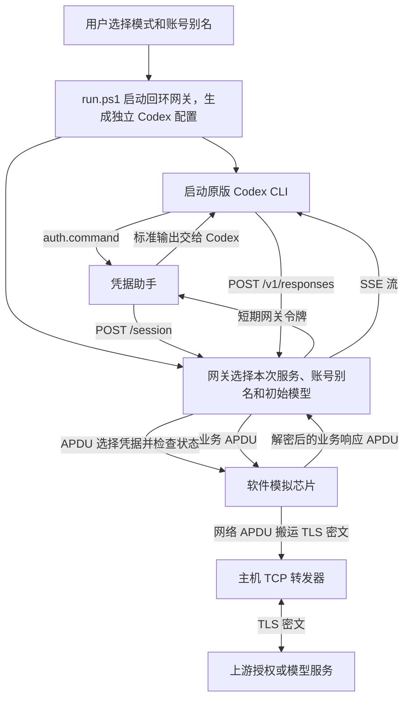
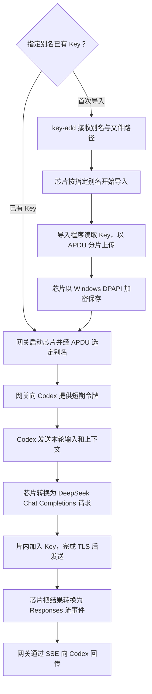
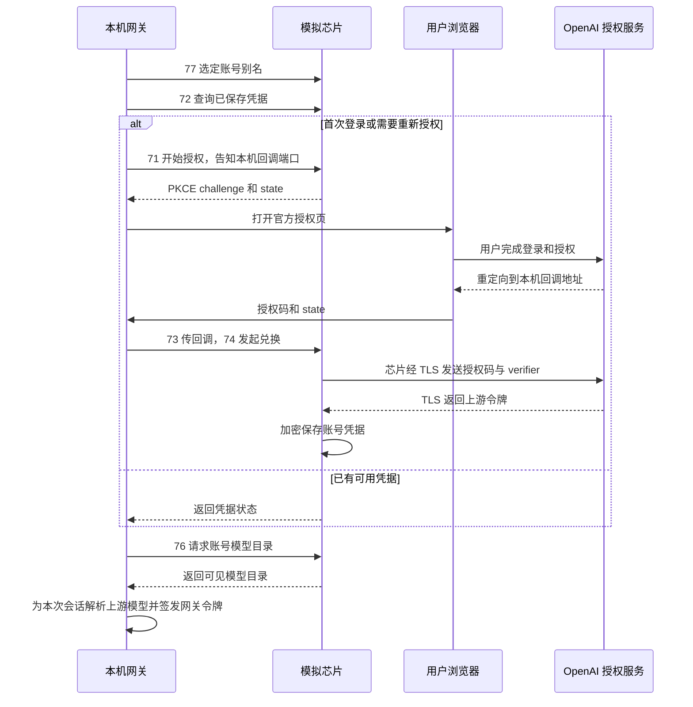
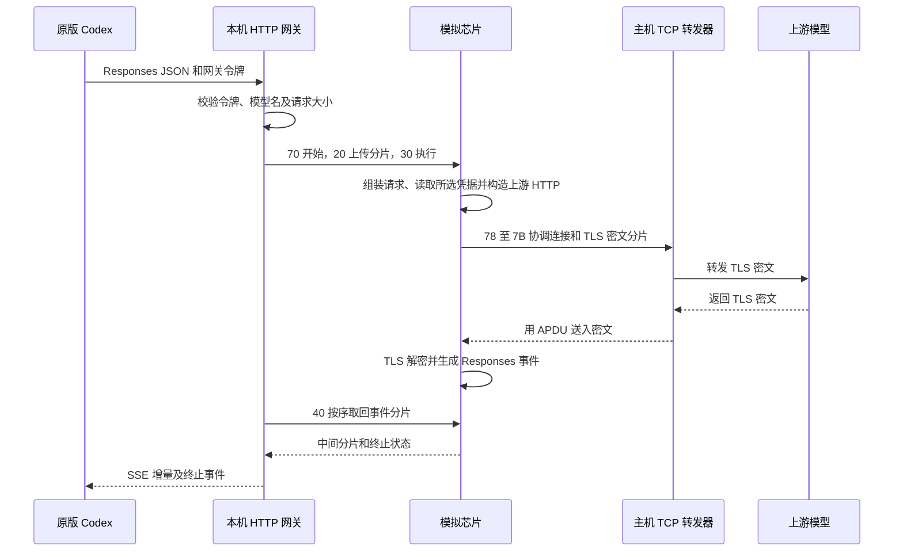
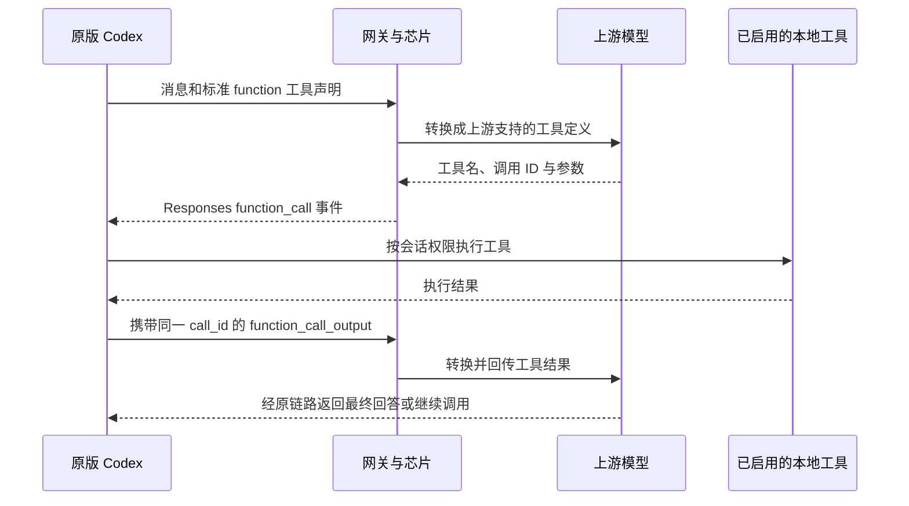

# Codex APDU 独立网关程序介绍与流程

这个 Windows 工程让原版 Codex CLI 通过本机网关调用模拟安全芯片。用户可以选择 **DeepSeek API Key** 或 **ChatGPT 账号授权**。两种模式共享同一个 Codex 接口，使用各自的芯片进程和凭据目录。原版 Codex 负责终端交互、组织上下文和执行已启用的工具。网关负责连接 Codex 与芯片，模拟芯片负责上游鉴权与 TLS。

## 一、启动和整体流程

在项目目录用 PowerShell 运行以下命令。菜单提供 ChatGPT 和 DeepSeek 的真实服务及离线演示。选择后进入原版 Codex。真实服务会接收对话内容，可能消耗账号额度。也可以通过 `-Mode` 跳过菜单，此时加 `-Live` 才会连接真实服务。

```powershell
pwsh -File .\run.ps1
pwsh -File .\run.ps1 -Mode deepseek -Live -Alias default
pwsh -File .\run.ps1 -Mode chatgpt -Live -Alias default
```

DeepSeek 第一次使用时，需要先通过 `key-add` 导入 Key 文件。ChatGPT 首次登录时，需要完成官方浏览器授权。构建和导入命令见 [运行说明](README.md)。



脚本为每次运行创建独立的 `CODEX_HOME`，把 `[model_providers.chip_gateway]` 的 `base_url` 指向 `127.0.0.1` 上的临时端口。真实模式启动时，脚本先调用凭据助手，以便在 Codex 终端启动前选定芯片凭据，并在需要时完成 ChatGPT 浏览器授权。原版 Codex 随后通过 `auth.command` 取令牌。退出时，启动脚本关闭网关并清理本次引导凭据。真实账号和 Key 的芯片存储位于 `.runtime/profiles`，供后续会话复用。 [配置模板](config.toml.template) · [启动脚本](run.ps1)

### 三类凭据各做什么

| 凭据 | 谁使用 | 用途 |
| --- | --- | --- |
| 本次运行的引导凭据 | 启动脚本、凭据助手、本机网关 | 证明凭据助手有权访问 `/session`，每次启动重新生成 |
| 短期网关令牌 | 原版 Codex、本机网关 | 调用本机 `/v1/responses`，有效期五分钟，随网关进程绑定到选定模式和别名 |
| DeepSeek Key 或 ChatGPT 上游令牌 | 模拟芯片及对应上游服务 | 上游 HTTPS 鉴权，ChatGPT Refresh Token 还用于续期 |

`/session` 和 `/v1/responses` 分别检查各自的凭据。网关把通过鉴权的业务 JSON 交给芯片，Codex 发送的本机认证头留在网关侧。 [网关 HTTP 入口](src/bin/gateway/http.rs)

## 二、模式一 · DeepSeek API Key



1. **导入**。导入工具用 `64` 指定操作和别名，再用 `65` 上传 Key、用 `66` 提交保存。来源文件与导入 APDU 当时承载明文 Key。日常模型调用使用芯片通过 DPAPI 保存的副本。 [Key 导入代码](src/live/management.rs)
2. **选定凭据**。网关用 `77` 指定别名，模拟芯片确认该别名存在后，将它绑定到本次业务会话。 [会话代码](src/live/mod.rs)
3. **发送**。芯片把 Responses 请求里的消息和支持的函数工具转换成 DeepSeek Chat Completions 格式，使用 `deepseek-flash`。它在片内构造 `Authorization` 头，并用 Mbed TLS 验证上游证书和服务名。DeepSeek 返回的数据流由芯片转换回 Codex 理解的 Responses 事件。 [DeepSeek 适配](src/live/deepseek.rs)

## 三、模式二 · ChatGPT 账号



**PKCE 和 state 各管一件事。** 芯片生成随机 `code_verifier`，再由它计算 `code_challenge`。浏览器授权请求携带 challenge，上游服务兑换授权码时验证 verifier 是否匹配。`state` 由芯片随机生成，浏览器回调要带回同一个值，芯片据此把回调绑定到当前授权事务。成功兑换时，芯片消费该事务；过期、state 不匹配或重复提交会被拒绝。项目的本机回调使用允许的 `1455` 或 `1457` 端口。 [芯片侧 PKCE 与 state](src/chatgpt/chip.rs) · [浏览器回调](src/chatgpt/callback.rs)

**已有授权时**，网关通过 APDU 查询状态和模型目录。芯片用片内 Access Token 向 ChatGPT 服务请求目录。默认配置 `apdu-chatgpt-auto` 是 Codex 面向网关发来的模型名，网关把它解析为账号目录中优先级最高的可见模型。需要指定初始模型时可以传 `-Model`。同一会话用 `/model` 切换后，网关按请求中的模型名转发，并检查该名称是否在当前账号目录中。

**上游 Token 临近到期时**，芯片在查模型或发送模型请求前检查有效期。需要刷新时，它经独立 TLS 连接用已保存的 Refresh Token 换取新 Access Token，并保存返回的新凭据。如果刷新失效，需要通过网关重新完成浏览器授权。本机网关令牌的续期由凭据助手与网关处理，两套有效期分别管理。 [上游令牌兑换、刷新与模型请求](src/chatgpt/service.rs) · [片内模拟存储](src/chatgpt/credentials.rs)

## 四、一轮对话如何收发



- **业务 APDU**承载 JSON 与模型返回事件，其中包含提示词、上下文和支持的工具结果。每片业务数据最长 255 字节，网关请求上限为 1 MiB。UTF-8 字符可以跨分片，芯片收齐后再解析。
- **网络 APDU**搬运 TLS 字节。`78` 查询连接状态，`79` 取出站密文，`7A` 写入站密文，`7B` 报告连接或关闭结果。主机根据目标白名单连到服务商，模拟芯片完成上游 TLS 握手、服务身份校验和解密。两字节连接编号占用数据域，因此密文数据每片最多 253 字节。
- **响应轮询**中，`6200` 表示业务仍在执行，可继续搬运网络数据并轮询；`6100` 表示当前有分片并可继续读取；`62F1` 表示真实模式的最后一段。网关把已收到的 Responses 事件流交给 Codex。断线、取消或超时会结束相应操作。 [协议常量](src/protocol.rs) · [网络转发](src/network/relay.rs)

## 五、除了对话，还可以使用 Tool 或 Skill 吗？

可以。需要同时看 **原版 Codex 支持的能力、会话配置允许的能力，以及芯片适配器能传递的数据格式**。原版 Codex 可以阅读和修改代码、运行命令、执行测试，也可通过 MCP 接入工具或加载 Skill。当前演示配置针对安全链路验收，使用只读权限，关闭了 Shell 工具、联网搜索、工具搜索、插件和多智能体等功能。 [当前会话配置](config.toml.template) · [官方 Codex 网关兼容要求](https://learn.chatgpt.com/docs/enterprise/gateway-compatibility)

### Tool 的执行和回传



ChatGPT 模式保留标准函数调用；DeepSeek 模式在 Responses 的 `function_call` 与 Chat Completions 的 `tool_calls` 之间转换。两种模式可回传字符串结果，或转换仅由文本段组成的结果。工具真正在哪里执行、是否获得文件或网络权限，由原版 Codex 及其运行环境控制。 [工具格式转换](src/functions_wire.rs) · [ChatGPT 适配](src/chatgpt/service.rs) · [DeepSeek 适配](src/live/deepseek.rs)

| 能力 | 这个工程里的实际情况 |
| --- | --- |
| 多轮文本、流式显示 | 两种真实模式均完成两轮验收 |
| 标准函数工具、文本结果回传 | 独立网关已实现；用原版 CLI 与本机模拟上游完成工具调用闭环。真实服务的本次验收覆盖对话 |
| 执行 Shell、写文件、跑测试 | 原版 Codex 具备此类能力。演示模板关闭 Shell、使用只读权限；启用后还需要分别验证工具的数据格式和运行权限 |
| MCP 工具 | 原版 Codex 可以接入。当前独立会话模板没有配置 MCP 服务。每个实际工具须验证其声明能否通过标准函数格式、结果是否为可回传的文本 |
| 图片及非文本工具输出、自定义工具协议、上下文压缩接口 | 属于待适配或单独验收的范围 |

离线工具验收可从项目目录运行 `pwsh -File .\run.ps1 -VerifyTools`。模拟服务选择原版 CLI 在该次会话声明的 `get_goal`，或可用的 `update_plan`，发出函数调用，再检查模型收到具有同一 `call_id` 的结果。 [工具测试入口](run.ps1) · [模拟模型实现](src/fixture.rs)

### Skill 在哪里使用

Skill 是由 `SKILL.md` 和可选的脚本、参考资料组成的工作流程。原版 Codex 可以根据描述选择 Skill，也可以由用户通过 `$技能名` 显式调用。Codex 发现并读取技能，把所需说明用于后续任务；如果技能要求调用工具，仍由当前会话的工具和权限决定能否执行。纯说明型 Skill 适合通过文本路径使用。含脚本、MCP 或图片输出的 Skill，需要逐项验证依赖和输出格式。 [官方 Skill 文档](https://developers.openai.com/codex/skills)

当前启动脚本每次生成独立 `CODEX_HOME`，并在该次运行的独立 `work` 目录启动 Codex。验证自定义 Skill 时，应先确保这个 Codex 会话能发现对应的 `SKILL.md`。插件和技能 MCP 依赖自动安装在模板中关闭。当前项目已验收标准工具闭环，自定义 Skill 的发现、显式调用及脚本执行还需分别验收。 [启动脚本](run.ps1) · [功能配置](config.toml.template)

## 六、真实验收与实验边界

| 验收项 | 已观察到的结果 |
| --- | --- |
| 真实 DeepSeek | 原版 Codex 经网关和 APDU 调用 `deepseek-flash`，两轮成功 |
| 真实 ChatGPT | 解锁已授权的芯片凭据，账号目录自动选中 `gpt-6.2-sol`，两轮成功 |
| 多轮上下文 | 第二轮复述了第一轮提供的测试标记 |
| 现有工程对照 | 旧工程的改造版 Codex 直接调度 APDU，新工程用原版 Codex 通过 HTTP/SSE 调用网关 |

软件模拟芯片和网关运行在同一台 Windows 主机。现阶段可以验证进程和协议层面的凭据流向。DeepSeek 初始文件导入、浏览器回调、Codex 对话历史以及同账户进程可访问的内存都应纳入实验边界。实体芯片的密钥隔离仍需硬件验证。 [真实联调结果](.build-cache/live-retest-e2b4cb5257594f6e841c7041de6e810a.status) · [旧版流程](../codex-apdu/apdu-demo/程序介绍与流程.md)
